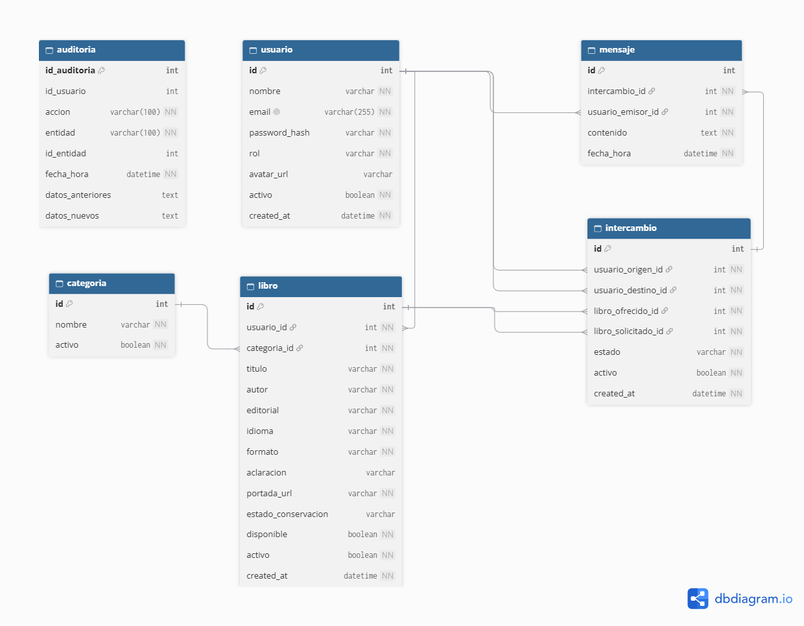
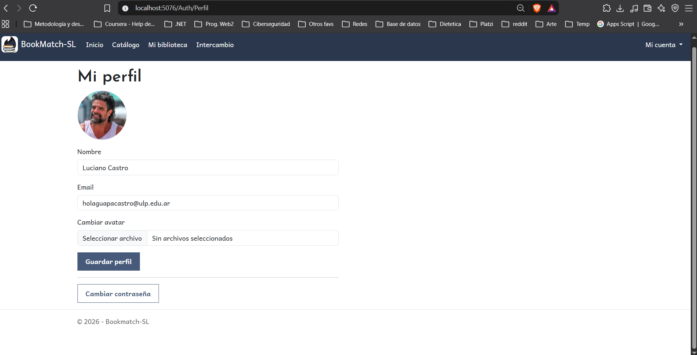
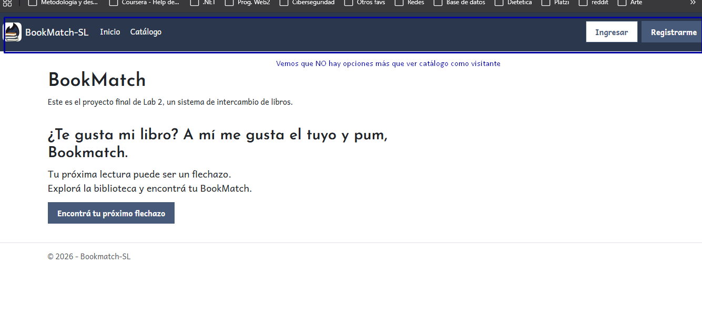
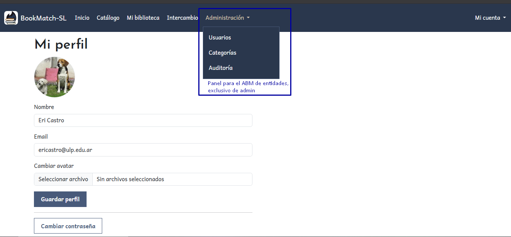

# Bookmatch-SL 📚

Plataforma web para el intercambio de libros físicos entre usuarios de San Luis.

Bookmatch-SL permite explorar un catálogo público de libros, publicar ejemplares propios, proponer intercambios y comunicarse con otros usuarios mediante un chat asociado a cada intercambio.

El sistema cuenta con autenticación, roles de usuario y administrador, gestión de libros, auditoría de operaciones y una API REST protegida mediante JWT.

---
### ⚠️ Nota Aclaratoria (Disclaimer)
Los usuarios de prueba y los libros cargados en el sistema tienen un tinte humorístico debido a una particularidad del equipo de desarrollo: **todos los integrantes que colaboramos en este proyecto compartimos el apellido "Castro"**. 

Las referencias o nombres utilizados (como Fidel Castro, Nelson Castro, etc.) se incluyeron exclusivamente como un juego de palabras interno y de prueba para el entorno de desarrollo. Bajo ningún punto pretenden ofender, hacer alusión política, ni fijar posición ideológica de ningún tipo.

---

# Matriz de evidencias de requerimientos mínimos

| Requerimiento mínimo | Estado | Enlace al código / controladores | Evidencia |
|---|---|---|---|
| **1. Modelo de datos y persistencia** | ✅ Cumplido | [BookDbContext.cs](./Data/BookDbContext.cs) · [Models](./Models/) | [Ver DER para la DB de BookMatch](./docs/evidencias/01-modelo-datos/BookMatch.png) |
| **2. Login, roles y avatar** | ✅ Cumplido | [AuthController.cs](./Controllers/AuthController.cs) · [UsuariosController.cs](./Controllers/UsuariosController.cs) | [Ver vista no autenticada](./docs/evidencias/02-autenticacion/noautenticado_Evidencia_punt2.png) • [Ver perfil rol usuario](./docs/evidencias/02-autenticacion/perfilLucianoCastro_Evidencia_punt2.png) • [Ver vista rol admin](./docs/evidencias/02-autenticacion/perfilEriCastro_Evidencia_punt2.png) |
| **3. Manejo de archivos adicional al avatar** | ✅ Cumplido | [LibroController.cs](./Controllers/LibroController.cs) · [ServicioPortada.cs](./Services/ServicioPortada.cs) | [Ver demostración](./docs/evidencias/3-manejo-de-archivos/) |
| **4. ABM con Vue.js + AJAX** | ✅ Cumplido | [Código Vue.js implementado para categoria](./Views/Categoria/Index.cshtml) | [Ver demostración](./docs/evidencias/04-vue/abm-categorias-vue-output.gif) | |
| **5. Paginación del lado del servidor** | ✅ Cumplido | [RepositorioLibro.cs](./Repositories/RepositorioLibro.cs) | [Ver evidencias](./docs/evidencias/05-paginacion/) |
| **6. Selección asíncrona de entidades relacionadas** | ✅ Cumplido | [IntercambioController.cs](./Controllers/IntercambioController.cs) | [Ver evidencias](./docs/evidencias/06-busqueda-ajax/) |
| **7. Web API REST + JWT** | ✅ Implementado | [AuthApiController.cs](./Controllers/Api/AuthApiController.cs) · [PerfilApiController.cs](./Controllers/Api/PerfilApiController.cs) | [Ver evidencias](./docs/evidencias/07-api-jwt/api-jwt-bearerpostmanseba.png) |

# Evidencias de implementación

## 1. Modelo de datos y persistencia

El proyecto utiliza Entity Framework Core para la persistencia de las entidades relacionadas.

Entidades principales:

- Usuario
- Categoría
- Libro
- Intercambio
- Mensaje
- Auditoría

Se implementan relaciones 1:N y entidades dependientes de otras dos, como Intercambio, que relaciona usuarios y libros.

**Código:**

- [BookDbContext.cs](./Data/BookDbContext.cs)
- [Carpeta Models](./Models/)

**Diagrama entidad-relación:**



*Diagrama de entidades, claves y relaciones de la base de datos.*

## 2. Login, roles y avatar

El sistema utiliza autenticación mediante cookies y dos roles: Usuario y Administrador.

Las funcionalidades administrativas están protegidas en el backend. Los usuarios pueden gestionar su perfil y cargar un avatar personalizado.

**Código:**

- [AuthController.cs](./Controllers/AuthController.cs)
- [UsuariosController.cs](./Controllers/UsuariosController.cs)
- [ServicioAvatar.cs](./Services/ServicioAvatar.cs)

**Perfil de usuario con avatar:**



*Captura del perfil de Luciano Castro con el avatar cargado.*

**Control de acceso por roles:**



*Captura que muestra las opciones administrativas*



*Captura de invitado al ingresar, no hay opción para ver perfil*

## 3. Manejo de archivos

Además del avatar, el sistema permite cargar imágenes de portada para los libros publicados.

Los archivos se validan y almacenan en el servidor dentro de `wwwroot/uploads/portadas`. En la base de datos se conserva la ruta de acceso a cada imagen mediante `PortadaUrl`.

**Código:**

- [LibroController.cs](./Controllers/LibroController.cs)
- [ServicioPortada.cs](./Services/ServicioPortada.cs)
- [Create.cshtml](./Views/Libro/Create.cshtml)
- [Edit.cshtml](./Views/Libro/Edit.cshtml)

**Demostración de carga de portada:**


*GIF: selección de imagen, publicación del libro y visualización de la portada.*

**Video completo:**

[▶ Ver demostración completa de carga y almacenamiento de portadas](REEMPLAZAR_POR_LINK_REAL_DEL_VIDEO)

**Archivo almacenado en el servidor:**


*Captura de la carpeta donde se almacenan las portadas.*

## 4. ABM con Vue.js + AJAX

El módulo permite realizar las operaciones de alta, baja, modificación y listado mediante una interfaz reactiva que se comunica con el servidor a través de AJAX y JSON, sin recargar la página.

**Código:**

- [Componente Vue](PENDIENTE_URL)
- [Controlador/API](PENDIENTE_URL)
- [Vista que integra Vue](PENDIENTE_URL)

**Demostración del ABM:**


*GIF mostrando el alta y listado de categoría*

**Video completo:**

[▶ Ver demostración del carga de una categoría reactivo si el gif se ve de mala calidad](https://drive.google.com/file/d/1fM65AhLEb1NdQK95lsVw_kka1g-UIxgF/view?usp=drive_link)

## Configuración de la base de datos local

- Cada integrante debe configurar la base en su pc.
- No guardar la contraseña en `appsettings.json` ni en otros archivos del proyecto. La conexión se guarda con User Secrets, como se explica a continuación.

### Paso 1: Crear la base

1. Abrir la herramienta que uses para administrar MySQL.
2. Abrir o importar el archivo `Data/bookmatch_sl.sql`.
3. Ejecutar el script completo para crear `bookmatch_sl` y sus tablas.

Esto se hace una sola vez! Los datos que agregues quedan en tu computadora.

### Paso 2: Guardar la conexión

La conexión se guarda con User Secrets para no subir la contraseña a GitHub!

1. Abrir la terminal en la carpeta `BookMatch-SL`, donde está el archivo `.csproj`.
2. Escribir `powershell` y presionar Enter. OJO!! La línea del comando debe comenzar con `PS`.
3. Si el `.csproj` no tiene un `UserSecretsId`, ejecutar:

```powershell
dotnet user-secrets init
```

** Si ya lo tiene configurado, saltear ese comando.**

Para guardar tu conexión, reemplazar `TU_USUARIO` y `TU_CONTRASEÑA` por tus datos de MySQL conservando las comillas dobles de la linea:

```powershell
dotnet user-secrets set "ConnectionStrings:DefaultConnection" "Server=localhost;Port=3306;Database=bookmatch_sl;User=TU_USUARIO;Password=TU_CONTRASEÑA;"
```

Si usás otro servidor o puerto, cambiar también `localhost` o `3306`.

Debe aparecer el mensaje:

```text
Successfully saved ConnectionStrings:DefaultConnection to the secret store.
```

### Paso 3: Generar y guardar la clave JWT

La app va a usar una clave secreta para firmar y validar los tokens JWT de la API. Cada uno debe generar su propia clave local.

```powershell
$key = [Convert]::ToBase64String(([System.Security.Cryptography.RandomNumberGenerator]::GetBytes(32))); dotnet user-secrets set "Jwt:Key" $key

```

Si por cualquier motivo no te funcionó el paso a paso sería copiar las siguientes líneas una por una:

```powershell
$rng = [System.Security.Cryptography.RandomNumberGenerator]::Create()
```
```powershell
$bytes = New-Object byte[] 64
```
```powershell
$rng.GetBytes($bytes)
```
```powershell
$key = [Convert]::ToBase64String($bytes)
```
```powershell
$rng.Dispose()
```
Finalmente, guardar la clave en User Secrets:
```powershell
dotnet user-secrets set "Jwt:Key" $key
```

### Paso 4: Ejecutar el proyecto

El proyecto incluye migraciones de EF dentro de la carpeta Migrations. Estas migraciones contienen la estructura de la base de datos definida en BookDbContext.

Si la herramienta dotnet-ef no está instalada, hay que instalar la versión compatible con la versión de Entity Framework Core del proyecto:
```powershell
dotnet tool install --global dotnet-ef --version 9.0.0
```
Si ya está instalada, no es necesario repetir la instalación.
```powershell
dotnet ef database update --context BookDbContext
```
Una vez configurada la conexión y creada la base de datos vacía, ejecutar desde la carpeta del .csproj:
```powershell
dotnet ef database update --context BookDbContext
```

### Paso 5: Ejecutar el proyecto


Primero, restaurar los paquetes y comprobar que el proyecto compile:
```powershell
dotnet restore
```
```powershell
dotnet build
```
Desde la misma terminal, ejecutar en modo desarrollo:

```powershell
dotnet run --environment Development
```

Abrir en el navegador la dirección que aparece en la terminal.

### Probar la API

La colección de Postman con las pruebas de la API está en `postman/BookMatch-SL.postman_collection.json`.

1. Con el proyecto corriendo, importar ese archivo en Postman.
2. En las variables de la colección completar `email` y `password` con un usuario de prueba.
3. Ejecutar primero el Login. El token se guarda solo y lo usan los otros pedidos.

Si la app corre en otra dirección, cambiar también la variable `baseUrl`.
